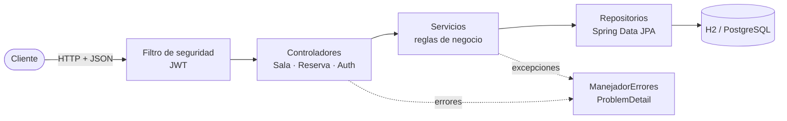
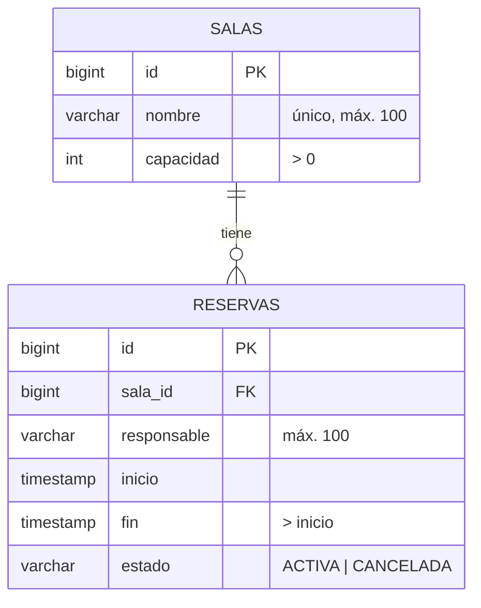
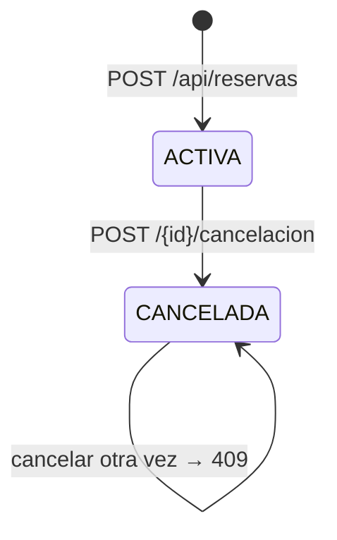
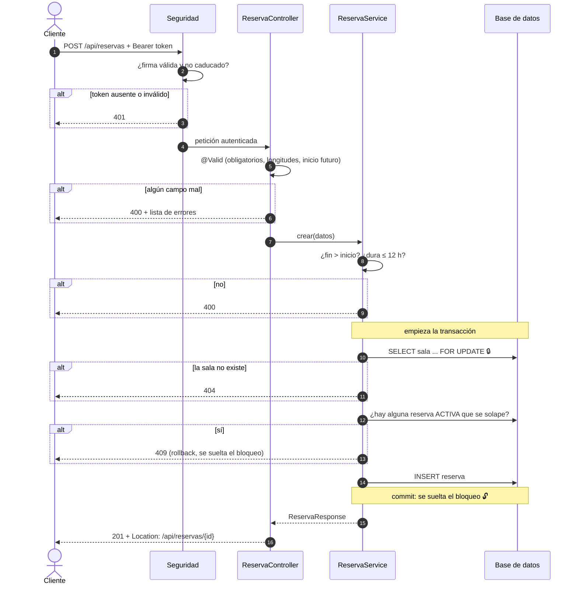
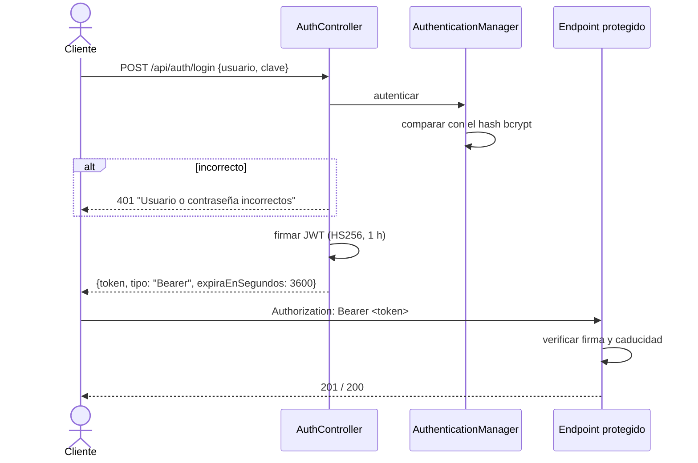

# 📘 Documentación técnica

Este documento cuenta **cómo está construida** la API por dentro. Para arrancarla, probarla o conocer las decisiones principales, empieza por el [README](../README.md).

**Índice**

1. [Visión general](#1-visión-general)
2. [Estructura del código](#2-estructura-del-código)
3. [Modelo de datos](#3-modelo-de-datos)
4. [Viaje de una reserva](#4-viaje-de-una-reserva)
5. [Concurrencia en detalle](#5-concurrencia-en-detalle)
6. [Seguridad](#6-seguridad)
7. [Validaciones y errores](#7-validaciones-y-errores)
8. [Consultas y paginación](#8-consultas-y-paginación)
9. [Configuración y perfiles](#9-configuración-y-perfiles)
10. [Migraciones](#10-migraciones)
11. [Estrategia de tests](#11-estrategia-de-tests)
12. [Glosario](#12-glosario)

---

## 1. Visión general

Es una aplicación Spring Boot clásica de tres capas: **controlador → servicio → repositorio**. Delante de todas ellas hay un filtro de seguridad, y al lado, un manejador de errores común.



| Capa | Qué hace | Qué **no** hace |
|---|---|---|
| Controlador | Recibe la petición, valida el formato (`@Valid`) y elige el código HTTP | Reglas de negocio |
| Servicio | Reglas de negocio y transacciones | Saber nada de HTTP |
| Repositorio | Hablar con la base de datos | Decidir nada |
| Entidad | Representar una fila y proteger su estado (`cancelar()`) | Exponerse directamente en la API (para eso están los DTO) |

**Tecnología:** Java 17 · Spring Boot 4.1 (Web MVC, Data JPA, Validation, Security, OAuth2 Resource Server) · Hibernate 7 · Flyway · H2 · PostgreSQL 17 · JUnit 5 · Mockito · Testcontainers.

---

## 2. Estructura del código

El código está organizado **por tema**, no por tipo de clase: todo lo de las reservas vive junto.

```
src/main/java/com/josue/reservas/
├── ReservasSalasApplication.java
├── sala/                      🏢 Salas
│   ├── Sala.java                 entidad
│   ├── SalaRepository.java       incluye la consulta con bloqueo (FOR UPDATE)
│   ├── SalaService.java
│   ├── SalaController.java       /api/salas
│   ├── CrearSalaRequest.java     DTO de entrada (con validaciones)
│   └── SalaResponse.java         DTO de salida
├── reserva/                   📅 Reservas
│   ├── Reserva.java              entidad (cancelar() cambia el estado)
│   ├── EstadoReserva.java        ACTIVA | CANCELADA
│   ├── ReservaRepository.java    solapamientos + listado con @EntityGraph
│   ├── ReservaService.java       ⭐ el corazón: reglas de reserva
│   ├── ReservaController.java    /api/reservas
│   ├── FiltroReservas.java       filtros opcionales → consulta dinámica
│   ├── CrearReservaRequest.java
│   └── ReservaResponse.java
├── seguridad/                 🔐 Autenticación
│   ├── SeguridadConfig.java      qué está protegido, JWT, bcrypt
│   ├── AuthController.java       /api/auth/login → emite el token
│   ├── PropiedadesSeguridad.java configuración validada al arrancar
│   ├── LoginRequest.java
│   └── TokenResponse.java
└── comun/                     🧰 Compartido
    ├── ManejadorErrores.java     excepción → respuesta HTTP
    ├── PaginaResponse.java       formato de las páginas
    ├── RecursoNoEncontradoException.java   → 404
    ├── DatosInvalidosException.java        → 400
    └── ConflictoException.java             → 409
```

**Regla de dependencias:** `reserva` usa `sala` (para buscar y bloquear la sala), pero `sala` no sabe nada de `reserva`. `comun` no depende de nadie.

---

## 3. Modelo de datos



**Restricciones en la base de datos** (por si alguien se salta la API):

| Restricción | Dónde | Qué garantiza |
|---|---|---|
| `uk_salas_nombre` | V1 | No hay dos salas con el mismo nombre |
| `ck_salas_capacidad` | V1 | Capacidad mayor que 0 |
| `fk_reservas_sala` | V1 | Toda reserva pertenece a una sala que existe |
| `ck_reservas_intervalo` | V1 | `fin` es posterior a `inicio` |
| `ck_reservas_estado` | V1 | El estado solo puede ser `ACTIVA` o `CANCELADA` |
| `ix_reservas_sala_inicio` | V1 | Índice por `(sala_id, inicio, fin)` para buscar solapamientos y filtrar rápido |
| `ex_reservas_sin_solapamiento` | V2 · solo PostgreSQL | **Nunca** hay dos reservas activas solapadas en la misma sala |

**Ciclo de vida de una reserva:**



Una reserva cancelada **no se borra**: sigue en el histórico y deja de ocupar el hueco.

---

## 4. Viaje de una reserva

Esto es lo que ocurre, paso a paso, cuando alguien hace `POST /api/reservas`:



Fíjate en el orden: **primero lo barato, después lo caro**. Las validaciones que no necesitan base de datos se hacen antes de abrir la transacción y bloquear nada.

---

## 5. Concurrencia en detalle

### ¿Cuándo se pisan dos reservas?

Se tratan como intervalos **semiabiertos** `[inicio, fin)`: el minuto final no cuenta. Dos reservas A y B se solapan si:

```
A.inicio < B.fin   Y   A.fin > B.inicio
```

```
10:00 ──── 11:00                         A
      10:30 ──── 11:30                   B  ❌ se solapa
                 11:00 ──── 12:00        C  ✅ consecutiva, no se solapa con A
09:00 ──────────────── 12:00             D  ❌ cubre a A entera
```

### Por qué hace falta un bloqueo

Sin bloqueo, dos peticiones simultáneas pueden intercalarse así:

| Tiempo | Petición 1 | Petición 2 |
|---|---|---|
| t1 | ¿Está libre? → sí | |
| t2 | | ¿Está libre? → sí |
| t3 | Guardo ✅ | |
| t4 | | Guardo ✅ 💥 **doble reserva** |

### Cómo lo resolvemos

`SalaRepository.buscarParaReservar` lee la sala con `@Lock(PESSIMISTIC_WRITE)`, que en SQL es `SELECT … FOR UPDATE`. La segunda petición se queda esperando en ese punto hasta que la primera termina:

| Tiempo | Petición 1 | Petición 2 |
|---|---|---|
| t1 | Bloqueo la sala 🔒 | |
| t2 | ¿Está libre? → sí | Bloqueo la sala… ⏳ espera |
| t3 | Guardo y hago commit 🔓 | ⏳ |
| t4 | | Obtengo el bloqueo 🔒 |
| t5 | | ¿Está libre? → **no** → 409 ✅ |

**¿Por qué funciona con el aislamiento por defecto (`READ COMMITTED`)?** En ese nivel, cada consulta ve lo último confirmado. Cuando la petición 2 obtiene el bloqueo, la reserva de la petición 1 ya está confirmada, así que la consulta de solapamiento la ve. No hace falta subir a `SERIALIZABLE`, que obligaría a reintentar transacciones.

**¿Por qué bloquear la sala y no las reservas?** Porque el hueco libre no es una fila que se pueda bloquear: lo que se quiere impedir es *insertar* una fila nueva. Bloquear la sala, que es la fila padre, sirve de «turno» para esa sala. Y las salas distintas no se esperan entre sí.

`buscarParaReservar` exige una transacción abierta (`Propagation.MANDATORY`). Si alguien la llamara fuera de una transacción, fallaría en vez de bloquear «en el aire» sin proteger nada.

### Escenarios revisados

| Escenario | Qué pasa |
|---|---|
| Dos peticiones al mismo hueco a la vez | Una entra y la otra espera y recibe un **409** |
| Solape parcial a la vez | Igual: la consulta de solapamiento lo detecta |
| Dos reservas consecutivas a la vez | Las dos entran (esperan su turno, pero no se solapan) |
| Misma hora en salas distintas | Las dos entran y no se esperan entre sí |
| Cancelación mientras otro reserva ese hueco | En el peor caso, el que reserva recibe un 409 prudente; **nunca** se produce un solapamiento |
| Error a mitad de la transacción | Rollback completo; el bloqueo se suelta al terminar la transacción |

### La red de seguridad de PostgreSQL

```sql
ALTER TABLE reservas
    ADD CONSTRAINT ex_reservas_sin_solapamiento
    EXCLUDE USING gist (sala_id WITH =, tsrange(inicio, fin, '[)') WITH &&)
    WHERE (estado = 'ACTIVA');
```

Se lee así: *«no puede haber dos filas con la misma `sala_id` (`=`) cuyos rangos `[inicio, fin)` se solapen (`&&`), contando solo las activas»*. Necesita la extensión `btree_gist` para combinar `=` sobre un número con `&&` sobre un rango.

Si alguna vez saltara, por ejemplo al escribir con SQL directo, `ManejadorErrores` la traduce a un **409** sin enseñar detalles internos.

### Pruebas que lo demuestran

- `ReservasConcurrentesTest` (H2) y `PostgresIntegrationTest` (PostgreSQL) lanzan 10 hilos que arrancan a la vez con un `CountDownLatch`. Solo uno debe tener éxito.
- **Comprobado que el test detecta el fallo:** al quitar el bloqueo, se guardaron las 10 reservas (`expected: 1 but was: 10`).

---

## 6. Seguridad

### Qué está protegido

| Petición | ¿Token? |
|---|---|
| `POST /api/auth/login` | No |
| `GET /api/**` (todas las consultas) | No |
| `POST /api/salas`, `POST /api/reservas`, `POST /api/reservas/{id}/cancelacion` | **Sí** |
| `/h2-console/**` | Solo existe en el perfil `dev` |
| Cualquier otra ruta | Sí (por defecto, todo cerrado) |

### Cómo se obtiene y se usa el token



**Contenido del token:**

```json
{ "iss": "reservas-salas", "sub": "admin", "iat": 1794829268, "exp": 1794832868, "roles": ["ROLE_ADMIN"] }
```

### Medidas aplicadas

- 🔑 **Contraseña con bcrypt**: al arrancar se convierte en un hash bcrypt, y el login compara siempre contra ese hash, nunca contra el texto en claro.
- 🤐 **El mismo mensaje** para usuario inexistente y contraseña incorrecta, para no dar pistas sobre qué usuarios existen.
- 🚫 **Sin sesión ni cookies** (`STATELESS`). Por eso CSRF está desactivado: ese ataque necesita cookies.
- 🧱 **Secreto validado al arrancar**: con menos de 32 caracteres, la aplicación no arranca.
- 🔒 **Sin credenciales por defecto fuera de `dev`**: si faltan, la aplicación no arranca (lo comprueba `ConfiguracionSeguraTest`).
- 🙈 **Los errores no enseñan trazas** ni mensajes internos de la base de datos.

### Pendiente (documentado en el README)

Limitar los intentos de login, validar también el emisor (`iss`), usuarios en base de datos con permisos por reserva y *refresh tokens*.

---

## 7. Validaciones y errores

### Dos capas de validación

| Capa | Dónde | Ejemplos |
|---|---|---|
| Cada campo por separado | Anotaciones en los DTO (`CrearReservaRequest`…) | Obligatorio, máximo 100 caracteres, `inicio` en el futuro, capacidad entre 1 y 1000 |
| Reglas entre campos | `ReservaService` | `fin` posterior a `inicio`, duración máxima de 12 h |
| Último recurso | Base de datos (`CHECK`, `UNIQUE`, `EXCLUDE`) | Lo mismo, por si alguien se salta la API |

### Catálogo de errores

Todas las respuestas de error usan [ProblemDetail (RFC 9457)](https://www.rfc-editor.org/rfc/rfc9457), así que el cliente siempre recibe la misma forma.

| Código | `title` | Cuándo |
|---|---|---|
| 400 | Datos inválidos | Algún campo no cumple las reglas. Incluye `errores: [{campo, mensaje}]` |
| 400 | Cuerpo no legible | JSON mal formado o fecha con formato incorrecto |
| 400 | Parámetro inválido | Un parámetro de la URL no es válido (`/reservas/abc`, `estado=BORRADA`, `fecha=10-01-2027`) |
| 401 | *(sin cuerpo)* | Falta el token, es falso o ha caducado |
| 401 | No autenticado | Login con credenciales incorrectas |
| 404 | No encontrado | La sala o la reserva no existe |
| 409 | Conflicto | Sala ocupada, nombre de sala repetido o reserva ya cancelada |

**Ejemplo:**

```json
{
  "title": "Conflicto",
  "status": 409,
  "detail": "La sala 'Azul' ya está reservada entre 2027-01-10T10:15 y 2027-01-10T10:45",
  "instance": "/api/reservas"
}
```

---

## 8. Consultas y paginación

### Filtros dinámicos

`FiltroReservas` convierte los filtros opcionales en una `Specification` de JPA: solo añade a la consulta las condiciones que llegan informadas. El filtro por `fecha` busca las reservas que **tocan** ese día:

```
inicio < (fecha + 1 día) a las 00:00   Y   fin > fecha a las 00:00
```

Por eso una reserva de 23:00 a 01:00 aparece en los dos días.

### Sin N+1

`ReservaRepository.findAll(spec, pageable)` lleva `@EntityGraph(attributePaths = "sala")`, así que la sala se trae en la misma consulta con un `JOIN`:

```sql
select r.*, s.* from reservas r join salas s on s.id = r.sala_id where ... order by r.inicio
```

Sin esto, listar 20 reservas costaría 21 consultas. Comprobado en el log de SQL: **1 consulta**.

### Límites

- Página por defecto: 20 elementos. Máximo: 100 (`spring.data.web.pageable.max-page-size`).
- Solo se puede ordenar por `id`, `inicio`, `fin`, `responsable` o `estado`. Cualquier otro campo da un 400 con la lista de los permitidos.

### Formato de la página

```json
{
  "contenido": [ { "id": 1, "salaId": 1, "salaNombre": "Azul", "...": "..." } ],
  "pagina": 0,
  "tamano": 20,
  "totalElementos": 6,
  "totalPaginas": 1,
  "ultima": true
}
```

---

## 9. Configuración y perfiles

| Perfil | Cuándo se activa | Base de datos | Credenciales | Consola H2 |
|---|---|---|---|---|
| `dev` | Si no se indica ninguno | H2 en memoria | Por defecto (`admin`/`admin123`) | ✅ |
| `postgres` | `--spring.profiles.active=postgres` | PostgreSQL | **Obligatorias** | ❌ |
| `dev,postgres` | Para desarrollar en local con PostgreSQL | PostgreSQL | Por defecto | ❌ |
| Cualquier otro (`prod`…) | — | H2, salvo que se configure otra cosa | **Obligatorias** | ❌ |

**Variables de entorno:**

| Variable | Obligatoria fuera de `dev` | Descripción |
|---|:---:|---|
| `APP_USUARIO` | ✅ | Usuario de la API |
| `APP_CLAVE` | ✅ | Su contraseña |
| `APP_JWT_SECRETO` | ✅ | Secreto para firmar los tokens (≥ 32 caracteres). Ej.: `openssl rand -base64 48` |
| `DB_URL` | | Por defecto `jdbc:postgresql://localhost:5432/reservas` |
| `DB_USER` / `DB_PASSWORD` | | Por defecto `reservas` / `reservas` |

**Archivos:**

| Archivo | Contenido |
|---|---|
| `application.properties` | Lo común: JPA, Flyway, paginación y seguridad **sin valores por defecto** |
| `application-dev.properties` | Credenciales de desarrollo y consola H2 |
| `application-postgres.properties` | Conexión a PostgreSQL |
| `compose.yaml` | PostgreSQL 17 para desarrollo local |

---

## 10. Migraciones

Flyway es el **único** que toca el esquema. Hibernate está en modo `validate`: si una entidad no coincide con las tablas, la aplicación no arranca.

| Versión | Archivo | Base de datos | Qué hace |
|---|---|---|---|
| V1 | `db/migration/V1__crear_salas_y_reservas.sql` | Todas | Tablas, claves, `CHECK` e índice |
| V2 | `db/vendor/postgresql/V2__restriccion_sin_solapamiento.sql` | Solo PostgreSQL | Extensión `btree_gist` y restricción de exclusión |

Flyway busca en `db/migration` y en `db/vendor/{vendor}`, donde `{vendor}` se sustituye por `h2` o `postgresql` según la base de datos. Así, cada base de datos recibe solo lo que entiende.

> ⚠️ `CREATE EXTENSION btree_gist` necesita permisos de superusuario o que la extensión esté permitida. En un PostgreSQL gestionado (RDS, Cloud SQL…) suele estar disponible, pero conviene comprobarlo antes de desplegar.

**Para añadir una migración:** crea `V3__descripcion.sql` en `db/migration`, o en `db/vendor/postgresql` si es específica de PostgreSQL. Nunca edites una migración que ya se haya aplicado.

---

## 11. Estrategia de tests

**16 tests**, elegidos para demostrar las reglas de negocio y detectar regresiones, no para inflar la cobertura.

| Test | Tipo | Base de datos | Qué demuestra |
|---|---|---|---|
| `ReservaServiceTest` (5) | Unitario, con Mockito | — | Reglas del servicio: sala libre u ocupada, fin posterior a inicio, máximo 12 h, no cancelar dos veces |
| `ApiReservasIntegrationTest` (5) | Integración, con MockMvc | H2 | La API de punta a punta: seguridad (401), validaciones (400), solapamientos (409), cancelación y filtros con paginación |
| `ReservasConcurrentesTest` (1) | Concurrencia | H2 | 10 reservas simultáneas → 1 éxito |
| `PostgresIntegrationTest` (3) | Integración, con Testcontainers | **PostgreSQL 17** | Migraciones V1 y V2, restricción de exclusión con SQL directo y concurrencia |
| `ConfiguracionSeguraTest` (1) | Arranque | — | Fuera de `dev`, sin credenciales no arranca |
| `ReservasSalasApplicationTests` (1) | Arranque | H2 | La aplicación levanta y las entidades encajan con las migraciones |

**Criterios que se siguieron:**
- **Cada test crea sus propios datos** (salas con nombre único), así que el orden de ejecución no importa.
- **El login es real** en los tests de integración, no simulado: se prueba también la cadena de seguridad.
- **Los tests de PostgreSQL se saltan si no hay Docker**, en vez de fallar.
- **Se comprobó que el test de concurrencia falla** cuando se quita el bloqueo, para descartar un falso positivo.

```bash
./mvnw test                              # todos
./mvnw test -Dtest=PostgresIntegrationTest  # solo PostgreSQL (necesita Docker)
```

---

## 12. Glosario

| Término | Significado |
|---|---|
| **Solapamiento** | Dos reservas de la misma sala cuyos horarios coinciden aunque sea un minuto |
| **Intervalo semiabierto `[inicio, fin)`** | Incluye el inicio pero no el fin; por eso 10–11 y 11–12 no chocan |
| **`SELECT … FOR UPDATE`** | Lectura que bloquea la fila hasta el final de la transacción |
| **`READ COMMITTED`** | Nivel de aislamiento en el que cada consulta ve lo último confirmado |
| **Restricción de exclusión** | Regla de PostgreSQL que impide filas que «choquen» entre sí según operadores (`=`, `&&`) |
| **N+1** | Antipatrón: 1 consulta para la lista más 1 por cada elemento |
| **ProblemDetail** | Formato estándar (RFC 9457) para respuestas de error en APIs HTTP |
| **JWT** | Token firmado que el cliente envía en cada petición para demostrar quién es |
| **Testcontainers** | Librería que levanta servicios reales (aquí PostgreSQL) en contenedores desechables durante los tests |
